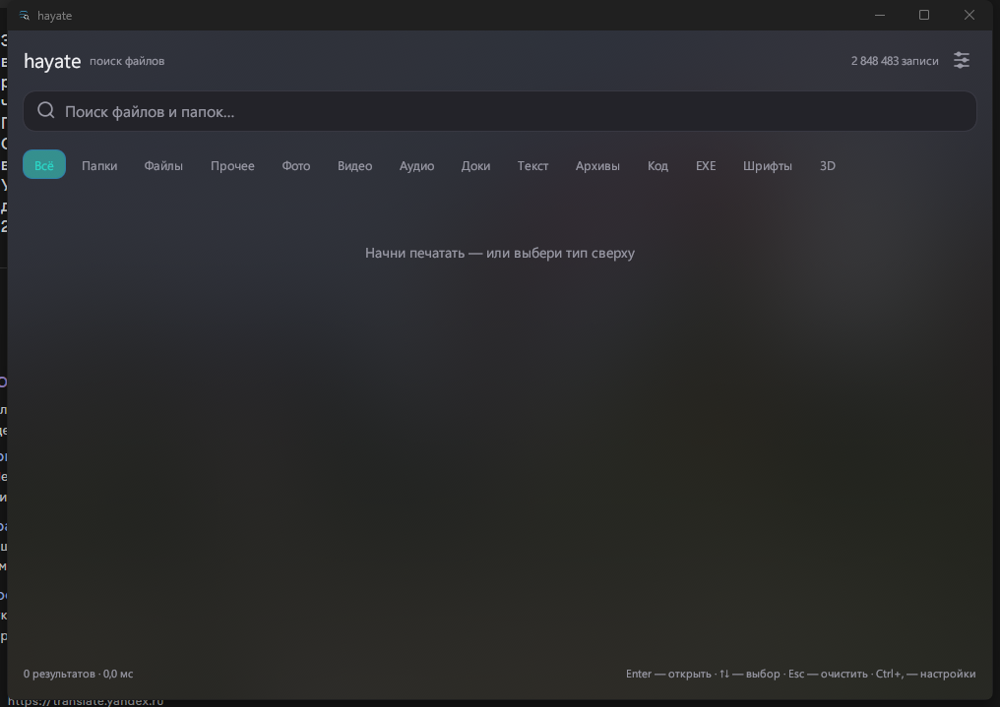
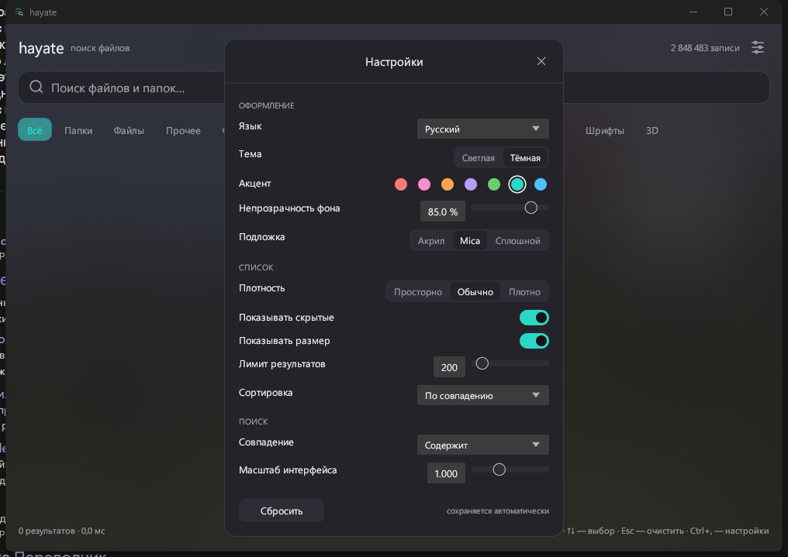

# hayate — 疾風

Instant file search for Windows and Linux. Rust, no Electron, no background indexer eating your disk.

**English** · [Русский](README.ru.md) · [中文](README.zh.md)

> **Early version (0.2).** The core works, but there are known rough edges: in "Acrylic" mode the background
> lags slightly when you drag the window (the screen is captured 5 times per second), and the index does not
> refresh itself yet. Install it if that's fine with you.

```
hayate                     # Windows 11 style GUI
hayate index               # scan all disks (≈7 s per 1M entries)
hayate tui                 # interactive search in the terminal
hayate find create -l 20   # console search
```



## Install (Windows)

1. Download `hayate-<version>-win64.zip` from the **Releases** page.
2. Extract the archive completely (don't run from inside the zip).
3. Run `hayate-setup.exe`.

The installer puts the app in `%LOCALAPPDATA%\Programs\hayate`, adds Start Menu and desktop shortcuts,
and registers an "Apps & features" entry for a clean uninstall.

Portable: just run `hayate.exe` from the archive.

Linux: `cargo build --release` and `./target/release/hayate`.

## Settings (gear icon in the top right, or Ctrl+,)



Everything is stored in `%LOCALAPPDATA%\hayate\settings.json` and applied on the fly:

- **Language**: English / Русский / 中文, or auto (system locale).
- **Theme**: dark / light.
- **Accent**: 7 Windows colors (blue, teal, green, purple, orange, pink, red).
- **Background opacity**: 20–100 % — real window alpha (100 % = solid).
- **Backdrop**: `Solid` / `Mica` (blurred wallpaper behind the UI) / `Acrylic` (live blur of whatever is behind the window).
- **Density**: compact / normal / relaxed.
- **Show hidden**, **show size** toggles.
- **Result limit**: 50–2000 (a "+" appears in the status bar when the cap is hit).
- **Sort**: relevance / name / size / date.
- **Match**: contains / from name start / whole name.
- **Interface scale**: 0.85–1.3.
- Window size is remembered.

## Features

- Index in memory and on disk: 5–20 ms searches over a million entries.
- Type filter: folders / files / images / video / audio / documents / text / archives / code / programs / fonts / 3D models.
- Exact extension filter (`-e jar`).
- Ranking: a match in the file name beats a match in the path; shorter paths rank higher.
- JSON output for scripting (`--json`).
- **Right-click opens the real Windows context menu**: Open, Open with (Notepad++, etc.), Copy, Properties.

## Commands

```
hayate index [DIRS...] [--exclude NAME]... [--out FILE]
hayate find "query" [-l 40] [-t image,video] [-e png] [--dirs|--files] [--json]
hayate tui
hayate stats
hayate bench "query" [-r 30]
```

Types for `-t`: `image, video, audio, doc, text, archive, code, exec, font, model, other`
(Russian synonyms work too: `картинки`, `видео`, ...).

Empty query + filter = "show me every file of this type":

```
hayate find "" -t video -l 10      # 10 video files from the disk
hayate find "" --dirs -l 20        # list directories
```

## TUI hotkeys

| Key | Action |
|---|---|
| typing | live search |
| Tab | next filter (all → folders → files → other → images → ...) |
| ↑ / ↓, PgUp / PgDn | move selection |
| Enter | open the file/folder in the system |
| Ctrl+U | clear the query |
| Esc / Ctrl+C | quit |

## Benchmarks (Xeon E5-2660v3, 10 cores, Win11)

| Operation | Result |
|---|---|
| Scan `C:\Users\Phiron` (938k entries, SSD) | 6.35 s · 147,685 files/s |
| Scan `C:\ + F:\ + Z:\` (2.85M entries, 868 GB) | 679 s · 4,197 files/s (HDD-bound) |
| 2.85M-entry index | 695 MB, ~1.1 s to load |
| Search "config" over 2.85M | 17.9 ms |
| Search "a" over 2.85M | 47.2 ms |
| Search "minecraft" over 2.85M | 21.7 ms |
| Empty query + "images" filter | 1.2 ms (938k) |

The first walker (jwalk + a stat call per entry) managed 3,000 files/s — 314 s for the home folder.
The current one uses `read_dir` with metadata from the directory entry, plus parallel level-by-level waves
that merge their shards.

Honestly: a full HDD scan takes minutes because every directory is read separately.
On NTFS this is solved by the USN journal (MFT read in one pass) — it's on the roadmap.

## Index format

A single little-endian file:

```
"HAYATE01" | n | len(buf) | len(fbuf) | len(roots) | roots | buf | fbuf | ends[] | fends[] | sizes[] | mtimes[] | attrs[]
```

- `buf` — all paths concatenated, `ends[i]` — end offset of the i-th path (u32).
- `fbuf`/`fends` — the same in lowercase for fast case-insensitive search.
- `attrs`: bit 0 — directory, bit 1 — hidden, bits 2..7 — file type.

Default location: `%LOCALAPPDATA%\hayate\index.bin` (Windows), `$XDG_CACHE_HOME/hayate/index.bin` (Linux).
Override with `HAYATE_INDEX`.

## Languages

The UI speaks English, Russian and Chinese. It follows the system locale by default and can be switched
in settings (`Language`). All strings live in one table in `src/lang.rs`, so adding a language means
adding one column.

## Roadmap

- [ ] USN journal / MFT on Windows — incremental updates in milliseconds instead of full rescans.
- [ ] inotify on Linux.
- [ ] Index compaction (u32 instead of u64 for size and mtime).
- [ ] Fuzzy search (fzf-style) as an alternative mode.
- [ ] Global hotkey + tray icon.

## Build

```
cargo build --release --bin hayate --bin hayate-setup
powershell -File tools/package.ps1 -Version 0.2.0   # dist/hayate-0.2.0-win64.zip
```

MIT licensed. Not affiliated with Microsoft.