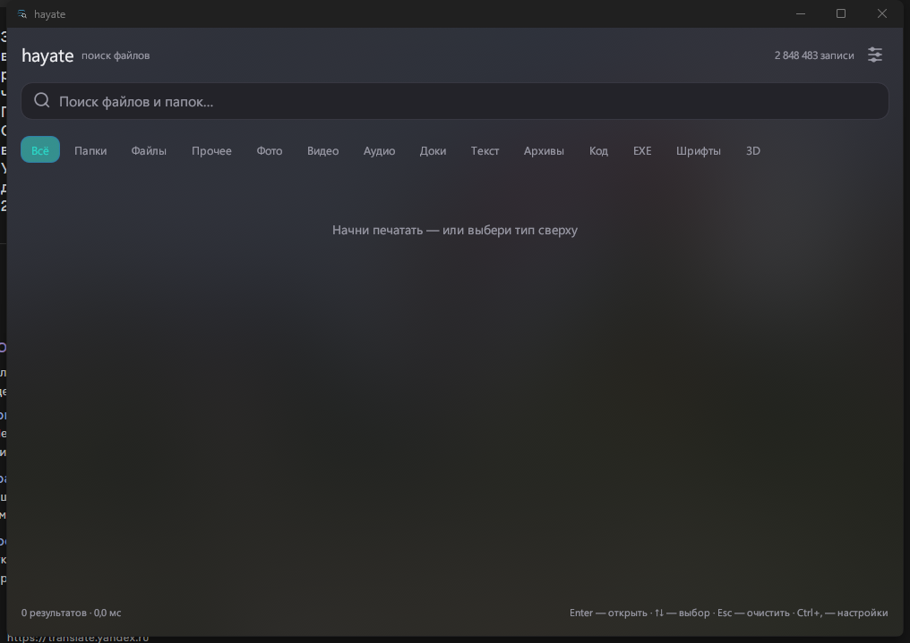
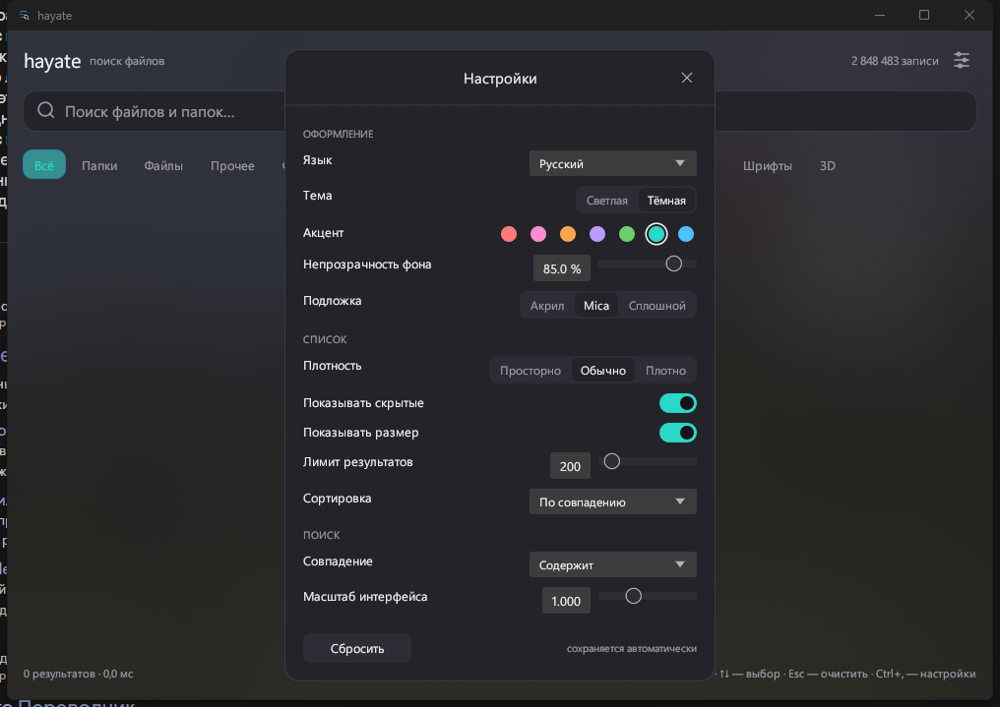

# hayate — 疾風

Мгновенный поиск файлов для Windows и Linux. Rust, без Electron, без индексации в фоне годами.

[English](README.md) · **Русский** · [中文](README.zh.md)

> **Ранняя версия (0.2).** Основное работает, но есть известные шероховатости: в режиме «Акрил» фон
> немного отстаёт при перетаскивании окна (снимок экрана обновляется 5 раз в секунду), а индекс пока
> не обновляется сам. Ставь, если готов к такому.

```
hayate                     # GUI в стиле Windows 11
hayate index               # просканировать все диски (≈7 с на 1 млн записей)
hayate tui                 # интерактивный поиск в терминале
hayate find create -l 20   # консольный поиск
```



## Установка (Windows)

1. Скачай `hayate-<версия>-win64.zip` со страницы **Releases**.
2. Распакуй архив целиком (не запускай изнутри zip).
3. Запусти `hayate-setup.exe`.

Дальше всё само: приложение встанет в `%LOCALAPPDATA%\Programs\hayate`, появятся ярлыки в меню Пуск и
на рабочем столе, а в «Параметры → Приложения» — запись для удаления.

Портативно (без установки): просто запусти `hayate.exe` из архива.

Linux: `cargo build --release` и `./target/release/hayate`.

## Настройки (шестерёнка справа сверху или Ctrl+,)



Всё сохраняется в `%LOCALAPPDATA%\hayate\settings.json` и применяется на лету:

- **Язык**: русский / English / 中文 или авто (по системе).
- **Тема**: тёмная / светлая.
- **Акцент**: 7 цветов Windows (синий, бирюзовый, зелёный, фиолетовый, оранжевый, розовый, красный).
- **Непрозрачность фона**: 20–100 % — настоящая альфа окна (при 100 % фон сплошной).
- **Подложка**: `Сплошной` / `Mica` (размытые обои под интерфейсом) / `Акрил` (живой блюр того, что за окном).
- **Плотность списка**: плотно / обычно / свободно.
- **Показывать скрытые**, **показывать размер** — тумблеры.
- **Лимит результатов**: 50–2000 (в статусе появляется «+», если упёрлись).
- **Сортировка**: по совпадению / имени / размеру / дате.
- **Совпадение**: содержит / с начала имени / имя целиком.
- **Масштаб интерфейса**: 0.85–1.3.
- Размер окна запоминается.

## Что умеет

- Индекс в памяти + на диске, поиск 5–20 мс на миллионе записей.
- Фильтр по типу: папки / файлы / картинки / видео / аудио / документы / текст / архивы / код / программы / шрифты / 3D-модели.
- Точный фильтр по расширению (`-e jar`).
- Ранжирование: совпадение в имени файла выше, чем в пути; короткие пути выше.
- JSON-вывод для скриптов (`--json`).

## Команды

```
hayate index [КАТАЛОГИ...] [--exclude ИМЯ]... [--out ФАЙЛ]
hayate find "запрос" [-l 40] [-t image,video] [-e png] [--dirs|--files] [--json]
hayate tui
hayate stats
hayate bench "запрос" [-r 30]
```

Типы для `-t`: `image, video, audio, doc, text, archive, code, exec, font, model, other`
(русские синонимы тоже работают: `картинки`, `видео`, ...).

Пустой запрос + фильтр = «покажи все файлы такого типа»:

```
hayate find "" -t video -l 10      # 10 видеофайлов с диска
hayate find "" --dirs -l 20        # список каталогов
```

## Горячие клавиши TUI

| Клавиша | Действие |
|---|---|
| печать | поиск на лету |
| Tab | следующий фильтр (всё → папки → файлы → прочее → картинки → ... ) |
| ↑ / ↓, PgUp / PgDn | выбор |
| Enter | открыть файл/папку в системе |
| Ctrl+U | очистить запрос |
| Esc / Ctrl+C | выход |

## Замеры (Xeon E5-2660v3, 10 ядер, Win11)

| Операция | Результат |
|---|---|
| Скан `C:\Users\Phiron` (938k записей, SSD) | 6.35 с · 147 685 файлов/с |
| Скан `C:\ + F:\ + Z:\` (2.85 млн записей, 868 ГБ) | 679 с · 4 197 файлов/с (узкое место — HDD) |
| Индекс на 2.85 млн | 695 МБ, загрузка ≈1.1 с |
| Поиск «config» по 2.85 млн | 17.9 мс |
| Поиск «a» по 2.85 млн | 47.2 мс |
| Поиск «minecraft» по 2.85 млн | 21.7 мс |
| Пустой запрос + фильтр «картинки» | 1.2 мс (938k) |

Первый вариант обхода (jwalk + stat на каждую запись) давал 3 000 файлов/с — 314 с на домашнюю папку.
Текущий: `read_dir` с метаданными из записи каталога + параллельные волны по уровням, шарды мержатся.

Честно: на HDD полный скан диска — это минуты, потому что обход читает каждый каталог отдельно.
На NTFS это лечится USN journal (чтение MFT одним потоком), он в планах.

## Формат индекса

Один файл, little-endian:

```
"HAYATE01" | n | len(buf) | len(fbuf) | len(roots) | roots | buf | fbuf | ends[] | fends[] | sizes[] | mtimes[] | attrs[]
```

- `buf` — все пути подряд, `ends[i]` — конец i-го пути (u32).
- `fbuf`/`fends` — то же в нижнем регистре для быстрого поиска без учёта регистра.
- `attrs`: бит0 — каталог, бит1 — скрытый, биты 2..7 — тип файла.

Путь по умолчанию: `%LOCALAPPDATA%\hayate\index.bin` (Windows), `$XDG_CACHE_HOME/hayate/index.bin` (Linux).
Переопределяется `HAYATE_INDEX`.

## Языки

Интерфейс на русском, английском и китайском. По умолчанию — по языку системы, переключается в настройках
(`Язык`). Строки лежат одной таблицей в `src/lang.rs`, чтобы добавить новый язык было достаточно дописать столбец.

## Дальше

- [ ] USN journal / MFT на Windows — инкрементальное обновление за миллисекунды вместо полного скана.
- [ ] inotify на Linux.
- [ ] Сжатие индекса (u32 вместо u64 для размера и mtime).
- [ ] Нечёткий поиск (fzf-style) как альтернативный режим.
- [ ] Глобальный хоткей + иконка в трее.
- [ ] Нативное контекстное меню Windows (Открыть / Открыть с помощью / Копировать / Свойства).

## Сборка

```
cargo build --release --bin hayate --bin hayate-setup
powershell -File tools/package.ps1 -Version 0.2.0   # dist/hayate-0.2.0-win64.zip
```

MIT. К Microsoft отношения не имеет.