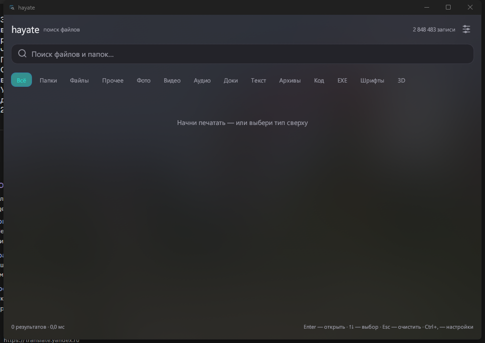
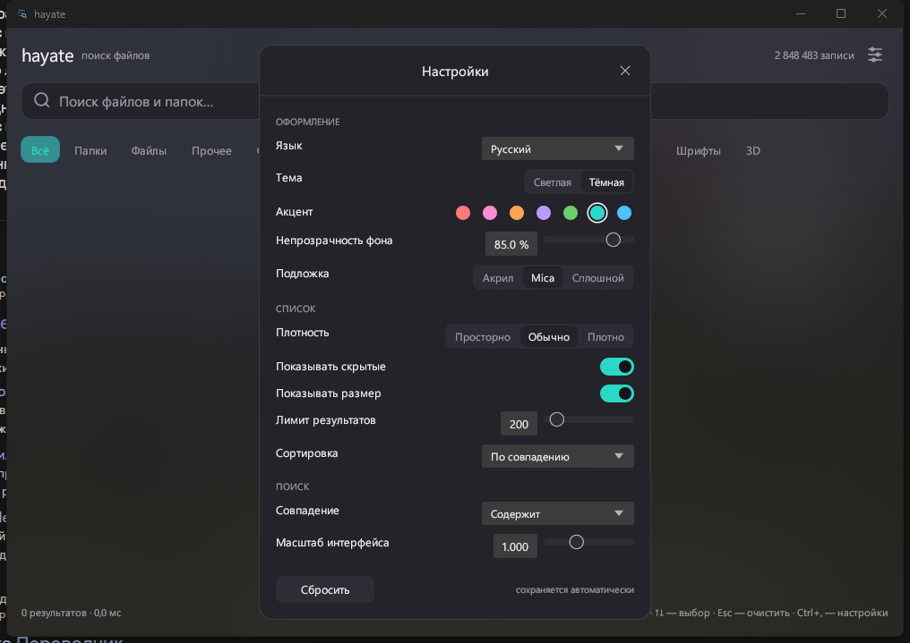

# hayate（疾风）

Windows 与 Linux 上的即时文件搜索。Rust 编写，不用 Electron，不会在后台长年扫描硬盘。

[English](README.md) · [Русский](README.ru.md) · **中文**

> **早期版本（0.2）。** 核心功能可用，但仍有已知问题：在「亚克力」模式下拖动窗口时背景会略微延迟
> （屏幕捕获为每秒 5 次），索引目前也不会自动更新。能接受再用。

```
hayate                     # Windows 11 风格界面
hayate index               # 扫描所有磁盘（100 万条约 7 秒）
hayate tui                 # 终端里的交互式搜索
hayate find create -l 20   # 命令行搜索
```



## 安装（Windows）

1. 从 **Releases** 页面下载 `hayate-<版本>-win64.zip`。
2. 完整解压（不要在压缩包里直接运行）。
3. 运行 `hayate-setup.exe`。

程序会安装到 `%LOCALAPPDATA%\Programs\hayate`，开始菜单和桌面会出现快捷方式，
并在「应用和功能」里登记卸载项。

便携模式：直接运行压缩包里的 `hayate.exe`。

Linux：`cargo build --release` 后运行 `./target/release/hayate`。

## 设置（右上角齿轮或 Ctrl+,）



全部保存在 `%LOCALAPPDATA%\hayate\settings.json`，修改即时生效：

- **语言**：中文 / English / Русский，或跟随系统。
- **主题**：深色 / 浅色。
- **强调色**：7 种 Windows 颜色。
- **背景不透明度**：20–100%（真实窗口透明度，100% 为不透明）。
- **底衬**：`纯色` / `Mica`（界面下方模糊壁纸）/ `亚克力`（实时模糊窗口后面的内容）。
- **列表密度**：紧凑 / 普通 / 宽松。
- **显示隐藏文件**、**显示大小**。
- **结果上限**：50–2000（达到上限时状态栏出现「+」）。
- **排序**：相关度 / 名称 / 大小 / 日期。
- **匹配方式**：包含 / 名称开头 / 完整名称。
- **界面缩放**：0.85–1.3。
- 窗口大小会被记住。

## 功能

- 内存 + 磁盘索引，百万条记录下搜索 5–20 毫秒。
- 类型筛选：文件夹 / 文件 / 图片 / 视频 / 音频 / 文档 / 文本 / 压缩包 / 代码 / 程序 / 字体 / 3D 模型。
- 精确扩展名筛选（`-e jar`）。
- 排序规则：文件名命中优先于路径命中；路径越短越靠前。
- 支持 JSON 输出（`--json`），方便脚本调用。
- **右键呼出 Windows 原生菜单**：打开、打开方式（Notepad++ 等）、复制、属性。

## 命令

```
hayate index [目录...] [--exclude 名称]... [--out 文件]
hayate find "查询" [-l 40] [-t image,video] [-e png] [--dirs|--files] [--json]
hayate tui
hayate stats
hayate bench "查询" [-r 30]
```

`-t` 的类型：`image, video, audio, doc, text, archive, code, exec, font, model, other`。

空查询 + 类型筛选 = 「列出该类型的全部文件」：

```
hayate find "" -t video -l 10      # 磁盘上的 10 个视频文件
hayate find "" --dirs -l 20        # 列出目录
```

## 终端界面快捷键

| 按键 | 作用 |
|---|---|
| 输入 | 即时搜索 |
| Tab | 切换筛选（全部 → 文件夹 → 文件 → 其他 → 图片 → ...） |
| ↑ / ↓、PgUp / PgDn | 选择 |
| Enter | 用系统默认程序打开 |
| Ctrl+U | 清空查询 |
| Esc / Ctrl+C | 退出 |

## 实测（Xeon E5-2660v3，10 核，Win11）

| 操作 | 结果 |
|---|---|
| 扫描 `C:\Users\Phiron`（93.8 万条，SSD） | 6.35 秒 · 147,685 文件/秒 |
| 扫描 `C:\ + F:\ + Z:\`（285 万条，868 GB） | 679 秒 · 4,197 文件/秒（受限于机械硬盘） |
| 285 万条索引 | 695 MB，加载约 1.1 秒 |
| 搜索「config」 | 17.9 毫秒 |
| 搜索「a」 | 47.2 毫秒 |
| 搜索「minecraft」 | 21.7 毫秒 |
| 空查询 + 图片筛选 | 1.2 毫秒（93.8 万条） |

最初的遍历方式（jwalk + 每条 stat）只有 3,000 文件/秒，用户目录要 314 秒。
现在的做法：`read_dir` 直接取目录项里的元数据，按层级并行扫描，最后合并分片。

说实话：机械硬盘全盘扫描仍要几分钟，因为每个目录都要单独读取。
NTFS 上可以用 USN journal（一次读取 MFT）解决，已在计划中。

## 索引格式

单个小端文件：

```
"HAYATE01" | n | len(buf) | len(fbuf) | len(roots) | roots | buf | fbuf | ends[] | fends[] | sizes[] | mtimes[] | attrs[]
```

- `buf` — 所有路径连续存放，`ends[i]` 为第 i 条路径的结束偏移（u32）。
- `fbuf`/`fends` — 同样内容的小写副本，用于快速不区分大小写搜索。
- `attrs`：第 0 位为目录，第 1 位为隐藏，第 2..7 位为文件类型。

默认位置：`%LOCALAPPDATA%\hayate\index.bin`（Windows）、`$XDG_CACHE_HOME/hayate/index.bin`（Linux）。
可用 `HAYATE_INDEX` 覆盖。

## 语言

界面支持中文、英文、俄文，默认跟随系统，可在设置里切换（「语言」）。
所有字符串集中在一张表里（`src/lang.rs`），加语言只需加一列。

## 后续计划

- [ ] Windows 上用 USN journal / MFT 增量更新，毫秒级而非全盘重扫。
- [ ] Linux 上的 inotify。
- [ ] 索引压缩（大小和修改时间用 u32 代替 u64）。
- [ ] 模糊搜索（fzf 风格）作为可选模式。
- [ ] 全局热键 + 托盘图标。

## 构建

```
cargo build --release --bin hayate --bin hayate-setup
powershell -File tools/package.ps1 -Version 0.2.0   # dist/hayate-0.2.0-win64.zip
```

MIT 许可。与微软无关。